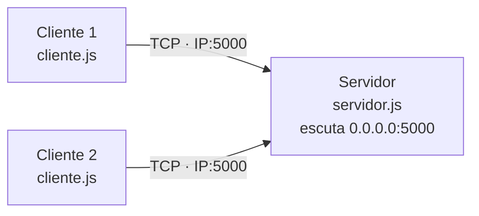

# Jogo da Forca em Rede (TCP)

Aplicação cliente-servidor desenvolvida em Node.js com **Programação em Sockets (TCP)** para a disciplina de **Fundamentos de Redes de Computadores**.

## Integrantes

| Nome | Matrícula |
|---|---|
|Marcos Samuel Cornelio Barros | 2025027554 |
|Bruno Vinicius dos Reis Souza | 2025034595 |
## 1. Descrição da aplicação

Jogo da forca em rede. O **servidor** sorteia uma palavra e guarda o estado da rodada de cada jogador. O **cliente** envia letras e recebe a palavra mascarada (ex.: `_ E _ E`) e o número de erros. A palavra secreta nunca é enviada ao cliente durante a rodada: só é revelada ao final (`VITORIA` ou `DERROTA`).

O servidor atende **vários clientes simultâneos**, cada um com sua própria rodada independente.

### Qual problema a aplicação resolve?

Mostra, de forma prática, como processos distintos (em máquinas diferentes ou na mesma) cooperam pela rede: o servidor mantém o estado e as regras do jogo, e os clientes apenas enviam comandos e exibem resultados.

## 2. Arquitetura




### Processos envolvidos

| Processo | Papel |
|---|---|
| `servidor.js` | Escuta na porta 5000, aceita conexões, guarda o estado de cada jogador, valida mensagens e responde |
| `cliente.js` (1 ou mais instâncias) | Inicia a conexão, envia comandos digitados pelo jogador e exibe as respostas |

### Como ocorre a comunicação

1. O servidor executa `listen` na porta 5000 e fica aguardando.
2. O cliente executa `connect` informando IP e porta do servidor. O TCP faz o *three-way handshake* (`SYN`, `SYN-ACK`, `ACK`).
3. Com a conexão estabelecida e persistente, o cliente envia mensagens de texto (uma por linha) e o servidor responde a cada uma.
4. Ao final, o cliente envia `SAIR` e a conexão é encerrada com `FIN` (ou o servidor detecta a queda abrupta via `RST`/`ECONNRESET`).

Cada conexão no servidor possui seu próprio socket e seu próprio estado, o que permite múltiplos jogadores ao mesmo tempo (o Node.js atende todos pelo laço de eventos).

## 3. Protocolo de transporte: TCP

### Justificativa

- **Confiabilidade:** cada `LETRA` e cada resposta precisam chegar. Perder uma mensagem desincroniza a rodada. O TCP garante a entrega com confirmação (ACK) e retransmissão.
- **Ordem:** a sequência de letras e respostas precisa ser respeitada. O TCP entrega os bytes na ordem em que foram enviados.
- **Conexão persistente:** o servidor mantém o estado de cada jogador enquanto a conexão existe e detecta quando um jogador cai (eventos `close` e `error`).
- **Sem requisito de tempo real:** o jogo é por interação simples; a latência adicional do TCP é imperceptível.
- **Baixo volume de dados:** mensagens de poucos bytes, então o overhead do TCP é irrelevante.

### O que aconteceria com UDP?

O UDP poderia ser utilizado para implementar o jogo, mas algumas características exigiriam cuidados adicionais na aplicação.

| Característica | Consequência para o jogo |
|---|---|
| Perda de datagramas | Uma mensagem `LETRA` poderia não chegar ao servidor, ou uma resposta `ESTADO` poderia não chegar ao cliente, deixando a tela desatualizada. |
| Falta de garantia de ordem | Mensagens poderiam chegar fora da ordem de envio, causando inconsistências entre as ações do jogador e o estado exibido. |
| Possibilidade de duplicação | Uma mensagem poderia ser recebida mais de uma vez, exigindo cuidados para evitar o processamento duplicado de uma jogada. |
| Ausência de conexão | O UDP não realiza o *three-way handshake* do TCP. O servidor precisa identificar cada jogador pelo endereço IP e pela porta de origem do datagrama, além de controlar sessões e timeouts. |
| Ausência de detecção automática de desconexão | O servidor não recebe um evento de encerramento de conexão como no TCP. Para detectar clientes inativos, seria necessário implementar timeouts ou mensagens periódicas (*heartbeats*). |
| Servidor desligado ou porta indisponível | Se o cliente enviar um datagrama para uma porta UDP sem um serviço ativo, o sistema operacional poderá retornar uma mensagem ICMP indicando que a porta está inacessível. |

### Observação prática: UDP e ICMP no Wireshark

Durante os testes, ao encerrar o servidor UDP e executar uma nova tentativa de comunicação pelo cliente, foi possível observar uma mensagem relacionada ao protocolo ICMP no Wireshark.

Isso ocorre porque, ao receber um datagrama destinado a uma porta UDP sem um processo escutando, o sistema operacional pode gerar uma mensagem **ICMP Destination Unreachable — Port Unreachable** (IPv4, tipo 3, código 3). Essa mensagem informa que não foi possível entregar o datagrama à aplicação de destino.

O ICMP não é uma resposta do protocolo UDP propriamente dito. Ele é utilizado pela camada de rede para comunicar condições de erro. Esse comportamento demonstra que, embora o UDP não garanta a entrega dos dados, outros mecanismos da rede podem informar determinadas falhas de entrega.

No Wireshark, é possível observar esse comportamento utilizando o filtro:

`udp.port == 5000 || icmp`

### Diferença na transmissão dos dados

No UDP, cada envio corresponde a um **datagrama**, que preserva os limites da mensagem enviada pela aplicação. Por exemplo, uma mensagem como `LETRA a` pode ser transmitida em um único datagrama UDP.

Já o TCP fornece um fluxo contínuo de bytes, sem preservar os limites das mensagens enviadas pela aplicação. Por isso, neste projeto TCP, foi necessário utilizar um buffer e o delimitador `\n` para reconstruir as mensagens recebidas.

Dessa forma, ao utilizar UDP, seria possível simplificar o tratamento dos limites das mensagens, mas seria necessário implementar mecanismos adicionais para lidar com perdas, duplicações, ordenação e identificação das sessões.

Para este jogo, o TCP continua sendo a escolha mais adequada, pois oferece entrega confiável e ordenada dos dados, sem exigir que a aplicação implemente esses mecanismos de transporte.

## 4. Endereço IP e porta

| Item | Valor |
|---|---|
| Porta | **5000** (TCP) |
| Servidor escuta em | `0.0.0.0:5000` (todas as interfaces de rede da máquina) |
| Cliente conecta em | IP da máquina do servidor, porta 5000 |
| Teste local | `127.0.0.1:5000` |
| Rede local | IP do servidor na LAN (ex.: `192.168.0.10:5000`) |

Os valores padrão ficam em `config.js`. O cliente aceita IP e porta por linha de comando, que têm prioridade sobre o `config.js`.

## 5. Protocolo da aplicação

Protocolo **textual**, próprio, com **uma mensagem por linha**:

```
COMANDO arg1 arg2 ...\n
```

- Campos separados por espaço.
- O caractere `\n` é o **delimitador** de mensagem. Como o TCP é um fluxo de bytes (não preserva fronteiras de mensagem), cliente e servidor usam um **buffer** que acumula os dados recebidos e só entrega a mensagem quando encontra o `\n`.
- Comandos não diferenciam maiúsculas de minúsculas.

### Mensagens

| Mensagem | Sentido | Significado |
|---|---|---|
| `ENTRAR <nome>` | Cliente → Servidor | Identifica o jogador e inicia uma rodada |
| `LETRA <x>` | Cliente → Servidor | Tenta uma letra (A-Z) |
| `SAIR` | Cliente → Servidor | Encerra a conexão educadamente |
| `OK <texto>` | Servidor → Cliente | Confirmação |
| `ESTADO <mascara> <erros> <max>` | Servidor → Cliente | Situação atual, ex.: `ESTADO _E_E 1 6` |
| `VITORIA <palavra>` | Servidor → Cliente | Jogador descobriu a palavra; nova rodada começa |
| `DERROTA <palavra>` | Servidor → Cliente | Erros esgotados; revela a palavra e começa nova rodada |
| `ERRO <codigo> <texto>` | Servidor → Cliente | Mensagem inválida ou ação não permitida |

### Códigos de erro

| Código | Significado | Situações em que ocorre | Fecha a conexão? |
|---|---|---|---|
| `100` | Comando desconhecido | Primeira palavra da linha não é `ENTRAR`, `LETRA` ou `SAIR` | Não |
| `101` | Argumentos inválidos | Quantidade errada de argumentos, nome inválido, letra fora de A-Z ou mensagem acima de 1024 caracteres | Só no caso de mensagem longa |
| `102` | Jogador já autenticado | `ENTRAR` enviado mais de uma vez na mesma conexão | Não |
| `103` | Ação não permitida | `LETRA` antes de `ENTRAR`, ou encerramento por inatividade | Só no caso de inatividade |
| `104` | Letra já tentada | `LETRA` repetida (não conta como erro) | Não |

### Exemplo de conversa

```
      CLIENTE                                            SERVIDOR
          │                                                 │
          │ ◄──────────── OK Conectado. Envie: ENTRAR <nome>|
          │                                                 │
          │ ─────────────── ENTRAR Dolinho ───────────────► │
          │                                                 │
          │ ◄────────── OK Ola, Dolinho! Descubra a palavra |
          │                                                 │
          │ ◄────────────── ESTADO ____ 0 6                 │
          │                                                 │
          │ ─────────────── LETRA e ─────────────────►      │
          │                                                 │
          │ ◄────────────── ESTADO _E_E 0 6                 │
          │                                                 │
          │ ─────────────── LETRA z ─────────────────►      │
          │                                                 │
          │ ◄────────────── ESTADO _E_E 1 6                 │
          │                                                 │
          │ ─────────────── LETRA e ─────────────────►      │
          │                                                 │
          │ ◄────────────── ERRO 104 Letra ja tentada       │
          │                                                 │
          │ ─────────────── SAIR ────────────────────►      │
          │                                                 │
          │ ◄────────────── OK Ate logo                     │
          │                                                 │
          │ ◄ - - - - - - FIM da conexão TCP - - - -        │
          │                                                 │
```

## 6. Tratamento de erros

## 6. Tratamento de erros
 
| Situação | Onde ocorre | Como é tratada |
|---|---|---|
| Comando desconhecido | Aplicação | Servidor responde `ERRO 100` e mantém a conexão |
| Argumentos inválidos | Aplicação | Servidor responde `ERRO 101` |
| Nome de jogador inválido | Aplicação | Servidor responde `ERRO 101`; o jogador pode tentar `ENTRAR` de novo |
| `ENTRAR` repetido | Aplicação | Servidor responde `ERRO 102` e preserva a rodada em andamento |
| Jogar sem `ENTRAR` | Aplicação | Servidor responde `ERRO 103` |
| Letra repetida | Aplicação | Servidor responde `ERRO 104` sem contar erro |
| Mensagem colada ou partida pelo TCP | Transporte | Buffer com delimitador `\n` reconstrói as mensagens |
| Mensagem maior que 1024 caracteres sem `\n` | Aplicação | Proteção contra consumo excessivo de memória: servidor responde `ERRO 101`, descarta o buffer e fecha a conexão |
| Cliente inativo por 60 segundos | Servidor | Evento `timeout`: servidor envia `ERRO 103` e fecha a conexão, liberando o socket |
| Escrita em socket já fechado | Servidor | `enviar` verifica `destroyed` e `writable` antes de escrever, evitando exceção |
| Servidor offline ou porta errada | Cliente | Evento `error` (`ECONNREFUSED`): mensagem clara e encerramento sem quebrar |
| Servidor inalcançável | Cliente | Evento `error` (`ETIMEDOUT`): mensagem clara |
| Servidor não responde | Cliente | Timeout de 10 segundos: mensagem clara e conexão encerrada |
| Queda abrupta do cliente | Servidor | Evento `error` (`ECONNRESET`) tratado e `close` registrado; os demais jogadores não são afetados |
| Servidor cai com cliente conectado | Cliente | Evento `close`: informa o encerramento |
| Porta já em uso | Servidor | Erro `EADDRINUSE` tratado com mensagem e saída limpa |
 
Regra principal: **o servidor nunca deve cair por causa do comportamento de um cliente.**

## 7. Estrutura do projeto

```
forca/
├── package.json         # {"type": "module"}
├── config.js            # IP, porta e transporte
├── protocolo.js         # comandos, códigos de erro, montar/interpretar e buffer
├── servidor.js          # servidor TCP e lógica da partida
├── cliente.js           # cliente TCP e interface no terminal
├── README.md
└── assets/
    └── arquitetura.png
```

## 8. Instruções de execução

**Requisitos:** Node.js 18 ou superior.

1. Na pasta do projeto, crie o `package.json` (se ainda não existir):

   ```json
   { "type": "module" }
   ```

2. **Servidor** (terminal 1):

   ```bash
   node servidor.js
   ```

3. **Cliente** (terminal 2, e outros terminais para mais jogadores):

   ```bash
   node cliente.js                        # usa 127.0.0.1:5000
   node cliente.js 192.168.0.10           # outro IP, porta 5000
   node cliente.js 192.168.0.10 5000      # IP e porta explícitos
   ```

4. No cliente, digite `ENTRAR <nome>`, depois as letras (basta digitar a letra, ex.: `e`) e `SAIR` para terminar.

**Em duas máquinas:** descubra o IP do servidor (`ipconfig` no Windows, `ip a` no Linux/Mac), use-o ao iniciar o cliente e libere a porta 5000 no firewall do servidor. As máquinas precisam estar na mesma rede.

## 9. Evidências do Wireshark

Captura feita com filtro `tcp.port == 5000` (interface de loopback para teste local).

| Evidência | O que mostra | Arquivo |
|---|---|---|
| Handshake de 3 vias | Pacotes `SYN`, `SYN-ACK` e `ACK` estabelecendo a conexão TCP | [3_vias.png](wire/3_vias.png) |
| Comando `ENTRAR` | Pacote `PSH, ACK` com `ENTRAR Dolinho` em texto claro | [entrar.png](wire/entrar.png) |
| Comando `LETRA` | Pacote `PSH, ACK` com `LETRA g` em texto claro | [letra.png](wire/letra.png) |
| Resposta `ESTADO` | Pacote `PSH, ACK` com `ESTADO ____ 0 6` (máscara inicial, nenhum erro) | [estado.png](wire/estado.png) |
| `ESTADO` após letra errada | Pacote `PSH, ACK` com `ESTADO ____ 1 6` (erros incrementados) | [estado_letra_errada.png](wire/estado_letra_errada.png) |
| Erro de inatividade | Pacote `PSH, ACK` com `ERRO 103 Inatividade, encerrando` | [erro_inatividade.png](wire/erro_inatividade.png) |
| Encerramento após 60 s | `FIN, ACK` do servidor fechando a conexão após o timeout de inatividade | [60s_inatividade_finaliza.png](wire/60s_inatividade_finaliza.png) |
| Captura completa | Arquivo `.pcapng` da conversa cliente-servidor (Follow TCP Stream) | [completo.pcapng](wire/completo.pcapng) |


## 10. Respostas às perguntas do projeto

| # | Pergunta | Resposta |
|---|---|---|
| 1 | Qual problema resolve? | Jogo da forca em rede, com servidor guardando a palavra e o estado de cada jogador |
| 2 | Processos envolvidos | `servidor.js` e uma ou mais instâncias de `cliente.js` |
| 3 | Como ocorre a comunicação? | Cliente conecta em IP:porta; troca de mensagens de texto por linha sobre uma conexão TCP persistente |
| 4 | Transporte escolhido | TCP |
| 5 | Por que TCP? | Seção 3 |
| 6 | Protocolo da aplicação | Protocolo textual próprio delimitado por `\n` (seção 5) |
| 7 | Mensagens trocadas | Tabela de mensagens (seção 5) |
| 8 | E se fosse UDP? | Seção 3 |
| 9 | Situações de erro | Tabela da seção 6 |
| 10 | Como são tratadas? | Tabela da seção 6 |

## 11. Limitações conhecidas

- O protocolo é textual e sem criptografia: o conteúdo (inclusive a palavra revelada ao fim da rodada) aparece em texto claro no Wireshark.
- Não há autenticação nem persistência de pontuação.
- O servidor não limita o número de conexões simultâneas.

## Referência

KUROSE, J.; ROSS, K. *Redes de Computadores e a Internet: Uma Abordagem Top-Down*. Capítulo 2: Camada de Aplicação (programação de sockets, protocolos de aplicação).
